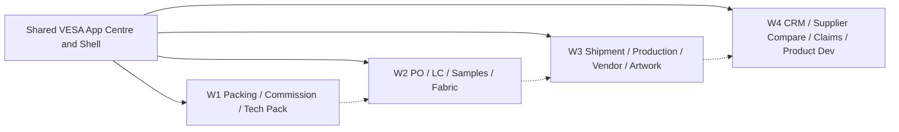

# VESA 360 - Phased Portfolio Delivery, Dependencies and Release

## P0 - Platform audit and stability gate (before building additional apps)

- Inspect actual VS Code branch, clean/dirty status, `main` comparison, existing local record/export safeguards and active demo publishing configuration.
- Read root and nested AGENTS files, current scope, unified UI contract, current progress, TNA/PPM/AQL trackers, separate Costing handover where applicable.
- Determine whether `main` has been promoted since the planning snapshot. **No automatic force-push, cherry-pick, merge or branch deletion.**
- Verify `templates/vesa-next-app/` rather than recreating the VESA header or starter from scratch.
- Keep new portfolio docs under `docs/roadmap/` only after conflict/overwrite audit.
- Approve one next app and exactly which requirement decisions are frozen for its MVP.

## Phase sequencing

### W1 - Immediate operational utilities; support typed manually verified PO/style references before the canonical PO app exists.

- **APP-01** Packing & Container 360 - complexity L, priority 1.
- **APP-02** Order & Commission 360 - complexity M, priority 2.
- **APP-03** Tech Pack & Spec 360 - complexity L, priority 3.

### W2 - Source documents, commercial obligations, sampling decisions and material records; integrate only explicit snapshots.

- **APP-13** Purchase Order 360 - complexity L, priority 4.
- **APP-05** LC & Payment 360 - complexity L, priority 5.
- **APP-04** Sampling & Approval 360 - complexity M, priority 6.
- **APP-06** Fabric & Trims 360 - complexity L, priority 7.

### W3 - Shipment execution, daily production, vendor evidence and version-controlled artwork; keep AQL/PPM authority unchanged.

- **APP-07** Shipment & Documentation 360 - complexity L, priority 8.
- **APP-09** Production Tracker 360 - complexity L, priority 9.
- **APP-08** Factory & Vendor 360 - complexity M, priority 10.
- **APP-10** Label & Artwork Approval 360 - complexity M, priority 11.

### W4 - CRM, offer comparison, claim management and product ideation; all records stay local and private.

- **APP-11** Buyer CRM 360 - complexity M, priority 12.
- **APP-12** Fabric & Supplier Comparison 360 - complexity M, priority 13.
- **APP-14** Claims & Disputes 360 - complexity M, priority 14.
- **APP-15** Product Development 360 - complexity M, priority 15.

### Dependencies that matter in practice

| Application | Can begin independently? | Before a linked/advanced feature becomes fully active |
|---|---|---|
| Packing | Yes | Needs verified PO/size/colour quantities; shipment export later |
| Commission | Yes | Needs entered signed commission agreement and sourced FOB basis; future PO import optional |
| Tech Pack | Yes | Needs buyer POM, spec units and grading rules; Sampling/Artwork link later |
| PO | Yes, but don't touch TNA existing order state | Needs authoritative buyer PO source and revision policy |
| LC | Yes as a standalone register | Needs verified LC terms, source start-event and bank docs |
| Sampling | Yes | Needs buyer approval category/authority; Tech Pack revision link for deeper parity |
| Fabric & Trims | Yes | Needs approved BOM/source consumption and QC disposition rules |
| Shipment Docs | Draft-only can begin | Requires approved packing/PO snapshot for reconciled shipping document |
| Production | Yes | Requires target and stage-unit/WIP conventions |
| Factory Vendor | Yes as a declared profile | Certification and compliance require actual issuing authority evidence |
| Artwork | Yes as revision register | Requires approved labels, GTIN sources and regulatory inputs for final claims |
| CRM | Yes with synthetic data | Real contacts require explicit local privacy controls |
| Supplier Comparison | Yes for entered quotations | Requires source comparability units, FX/date and quoted terms |
| Claims | Yes for internal cases | Monetary settlement requires approved case authority |
| Product Development | Yes | Tech Pack promotion only after explicit matching source/review |

## Same lifecycle for each app: five milestones

- **M0 AUDIT:** Actual file inspection, source-of-truth map, dependency/record owner, approved patch scope and rollback plan; no code edits until complete.
- **M1 ENGINE:** Versioned immutable record model, pure JS domain calculations, negative guards, synthetic unit tests. Do not guess buyer/customer terms.
- **M2 LOCAL WORKSPACE:** Reuse VESA shell; implement user-friendly forms, four languages, mobile, save/reopen and downloaded saved-copy with atomic import.
- **M3 REPORTS / REFERENCES:** Source-backed report/Excel/print, explicit manual cross-app reference, revision history and safe offline behavior.
- **M4 PROOF / HANDOFF:** Focused tests, cross-app impact review, automated browser/screenshots, versioned release notes and separate demo publication authorization when requested.

If missing buyer policy affects one narrow feature, label only that feature `NEEDS_APPROVED_POLICY` and continue independent, reversible modules. Never hide missing evidence or claim fake UAT passes.

## Dependencies and source of truth

Dotted arrows are planned documentation/reference improvements, not compulsory technical imports or automated synchronizations. Each app remains operable with manual sourced inputs when dependencies have not been built yet.

## Branch and demonstration release rules

1. Keep ONE public source repository. `main` is the stable publishing baseline. Create short-lived `feature/<slug>-360` for a selected new app only; do not create 15 branches simultaneously.
2. At each accepted checkpoint, commit only bounded files with clear message and verified test summary. No real customer/buyer records in source or Git history.
3. Before a demo merge, inspect actual `git log` / `git diff main...feature` / branch protection; avoid force push; preserve saved copies and current production code.
4. Execute focused app/domain/browser tests during development and full relevant cross-app suite at a meaningful integration/release boundary, not after every tiny wording change.
5. Automatic browser tests capture their own screenshots. Do not require the user to manually answer each UAT line. Record genuine human/physical acceptance separately as NOT TESTED when absent.
6. For personal non-commercial demo publication, verify the actual GitHub Pages source/settings, content/use suitability, secrets/security and root service-worker compatibility. Treat Pages as public code/static demo, not secure sign-in or a commercial SaaS server.
7. Deploy ONLY after a separately named demo release request or existing explicit authorization is confirmed by Codex, exact target branch/SHA is recorded, all technical checks pass and a non-destructive rollback path exists.
8. After verifying the live demo routes and preserving the commit reference, merged feature branches may be deleted only after confirming remote merge and backups. Do not delete local branches with uncommitted work.

## Optional parallel streams (not automatic)

The overall portfolio may have specs prepared in parallel, but only one shared-shell/platform owner change at a time. Different app-domain engines can be worked independently if each has its own scoped branch; avoid simultaneous edits to `js/preferences.js`, `js/app-catalogue.js` or shared shell without controlled merge resolution.

## Estimate policy

Complexity `M`/`L` is comparative, not an estimated calendar deadline. Provide genuine calendar estimates only after Codex audits the actual app files, test baseline, approved policies, and available developer capacity. Missing buyer approvals and physical testing must not be disguised as engineer effort.